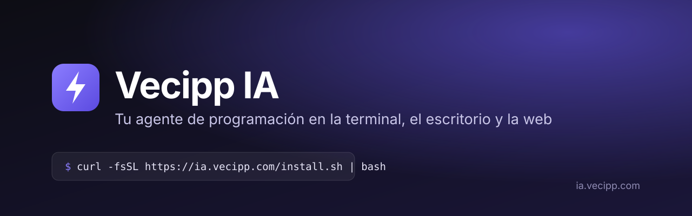

<p align="center">
  
</p>

<p align="center">
  <a href="https://github.com/DangerDutyJS/Vecipp-IA-Releases/releases/latest"></a>
  
  
  <a href="https://ia.vecipp.com"></a>
</p>

<p align="center">
  <a href="https://ia.vecipp.com"><b>Sitio</b></a> ·
  <a href="https://ia.vecipp.com/descargas"><b>Descargas</b></a> ·
  <a href="https://ia.vecipp.com/docs"><b>Documentación</b></a> ·
  <a href="https://ia.vecipp.com/precios"><b>Planes</b></a> ·
  <a href="CHANGELOG.md"><b>Novedades</b></a>
</p>

---

**Vecipp IA** es un agente de programación con IA. Lee y edita tu código, corre comandos, se conecta por SSH a tus
servidores, usa el navegador y entrega documentos, páginas y diseños listos para ver. Una sola cuenta Vecipp para los
tres:

| | Para qué | Dónde trabaja |
|---|---|---|
| 🖥️ **CLI** (`vecipp`) | El agente completo en tu terminal | Tu PC o tu VPS: cualquier carpeta, varias shells, SSH, bases de datos, pruebas |
| 🪟 **Escritorio** | El mismo agente con ventana propia | Las carpetas de tu PC |
| 🌐 **Web** ([ia.vecipp.com](https://ia.vecipp.com)) | Chat, y **Código en la nube** sobre tus repos de GitHub | El navegador, sin instalar nada |

Tu uso, tus sesiones y tus artefactos se comparten entre los tres.

## Instalación

**Windows** (PowerShell):

```powershell
irm https://ia.vecipp.com/install.ps1 | iex
```

**macOS · Linux · VPS**:

```bash
curl -fsSL https://ia.vecipp.com/install.sh | bash
```

No piden permisos de administrador ni `sudo`: si no tienes Node.js 20+, instalan uno solo para tu usuario, y comprueban
la firma SHA-256 de todo lo que descargan. Para actualizar, la misma línea.

**Escritorio para Windows**: [descargar el instalador](https://ia.vecipp.com/descargas) (también en
[Releases](https://github.com/DangerDutyJS/Vecipp-IA-Releases/releases/latest)).

## Primeros pasos

```bash
cd mi-proyecto
vecipp                     # o vecipp-cli
```

1. Escribe `/login` e inicia sesión con tu cuenta Vecipp (se abre el navegador).
2. Elige el proveedor **Vecipp IA** con `/provider`: usa tu cuenta, sin API key. (También puedes traer tu propia API key
   de NVIDIA, Groq, OpenRouter y otros.)
3. Pídele lo que necesites: *«arregla el error de la página de pagos y corre las pruebas»*.

### Comandos

| Comando | Qué hace |
|---|---|
| `/model` | Cambiar de modelo (`/model auto`: el más fuerte disponible que responda) |
| `/uso` | Tu uso: la sesión de 5 horas y la semana, el mismo de la web y el escritorio |
| `/artifacts` · `/open` | Los documentos, páginas y diseños que creó el agente, con su enlace en ia.vecipp.com |
| `/sync on\|off` | Ver tus sesiones de la terminal en [ia.vecipp.com/code](https://ia.vecipp.com/code) |
| `/resume` · `/sessions` · `/history` | Retomar una sesión guardada |
| `/plan` · `/planmode` · `/auto` | Ver el plan · pedir permiso en cada acción · aprobar cambios solo |
| `/diff` · `/context` · `/compact` | Cambios pendientes · uso del contexto · resumir para liberar contexto |
| `/vps` | Conectar un servidor por SSH |
| `/init` | Analizar el proyecto y crear `VECIPP.md` |
| `/tools` · `/agent` · `/help` | Herramientas disponibles · rol del agente · ayuda |

Opciones al abrir: `vecipp -C <carpeta>`, `vecipp --no-vps`, `vecipp --version`.

## Qué puede hacer

- **Trabajar en tu código**: leer, buscar, editar y crear archivos; mostrarte cada cambio antes de aplicarlo.
- **Correr cosas de verdad**: comandos, varias shells a la vez, procesos en segundo plano, pruebas y compilaciones.
- **Tus servidores**: conectarse por SSH a tu VPS y trabajar ahí con las mismas herramientas.
- **Artefactos como en Claude**: los documentos, páginas y diseños que crea se guardan en tu cuenta y se abren solos en
  el navegador, ya renderizados.
- **Tu historial en todas partes**: tus sesiones de la terminal y el escritorio se ven en la web.
- **Un solo uso para todo**: la sesión de 5 horas y la semana son las mismas en la web, la CLI y el escritorio.

## Planes

Hay un plan **Gratis** con uso que se renueva cada 5 horas y cada semana, y planes con más uso y más modelos. Precios y
detalles en [ia.vecipp.com/precios](https://ia.vecipp.com/precios). Con tu propia API key, la CLI y el escritorio no
gastan tu plan.

## Privacidad

Tu código se queda en tu equipo: el agente lee y edita archivos ahí. Al modelo solo le llega lo necesario para cada
paso. Los artefactos y las sesiones sincronizadas se guardan en tu cuenta, y puedes apagarlo (`/sync off`,
`/artifacts open off`).

## Versiones y ayuda

- **Novedades**: [CHANGELOG.md](CHANGELOG.md) y [Releases](https://github.com/DangerDutyJS/Vecipp-IA-Releases/releases).
- **Documentación**: [ia.vecipp.com/docs](https://ia.vecipp.com/docs).
- **Soporte**: [soporte.vecipp.com](https://soporte.vecipp.com).

---

<sub>© Vecipp. Software propietario: este repositorio publica los instaladores, las novedades y la documentación de
Vecipp IA, no su código fuente. Ver [LICENSE.md](LICENSE.md).</sub>
